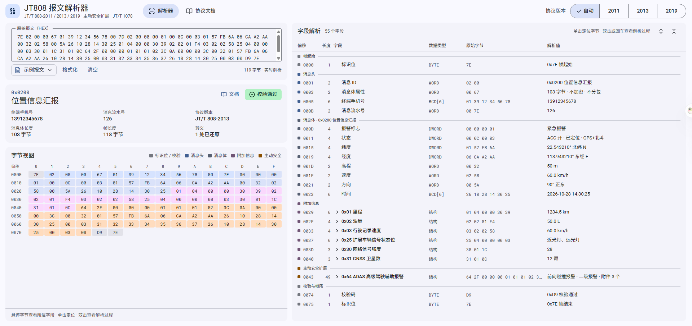
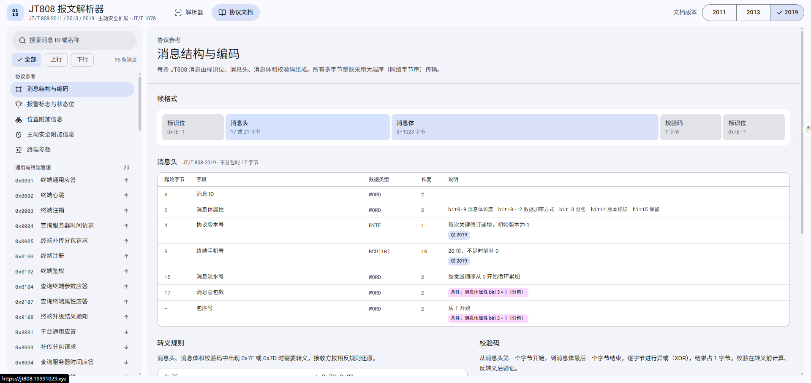

# JT808 报文解析器

JT/T 808-2011 / 2013 / 2019 部标协议报文在线解析工具，支持主动安全扩展（ADAS / DSM / TPMS / BSD，苏标 T/JSATL 12-2017 与粤标 T/GDRTA 002-2020）与 JT/T 1078。

主动安全报文按报警标识号结构自动识别标准：苏标 16 字节（终端 ID 7），粤标 40 字节（终端 ID 30）；无法识别时 2011/2013 按苏标、2019 按粤标。

在线访问：https://ssssshql.github.io/jt808-parser/



## 功能

- 粘贴 16 进制报文，自动识别消息 ID、转义还原、校验码验证
- 按字段展示解析值与解析过程，支持位定义展开；左侧字节视图与字段表格双向联动
- 内置协议文档：消息结构、报警标志与状态位、位置附加信息、主动安全、终端参数
- 支持 2011 / 2013 / 2019 三个版本自动识别与手动切换
- 内置示例报文，一键加载体验



## 技术栈

Vite 5 + React 18 + TypeScript + Tailwind CSS + Framer Motion

## 本地开发

```bash
npm install
npm run dev
```

## 构建

```bash
npm run build
```

## 部署

产物使用**相对资源路径 + HashRouter**，一份 `dist` 可部署在任意目录（域名根目录、任意子路径、多层子路径），无需按路径重新构建。

### GitHub Pages

推送到 `main` 分支后，GitHub Actions 自动构建并部署。

> 首次使用需在仓库 Settings → Pages 中将 Source 设置为 **GitHub Actions**。

### 自有服务器：FTP 自动部署

推送到 `main` 后，`deploy-ftp.yml` 会自动构建并把 `dist` 同步到 FTP 站点目录。

在仓库 **Settings → Secrets and variables → Actions → New repository secret** 添加：

| Secret | 值 | 说明 |
| --- | --- | --- |
| `FTP_SERVER` | `158.101.4.164` | FTP 主机 |
| `FTP_USERNAME` | FTP 账号 | |
| `FTP_PASSWORD` | FTP 密码 | |
| `FTP_SERVER_DIR` | `/www/wwwroot/jt808/` | 站点根目录，不填默认为 `/` |

> `dangerous-clean-slate` 默认关闭，同名文件会被覆盖、旧文件保留。若要完全清空重传，把它改为 `true`（确认 `FTP_SERVER_DIR` 就是站点目录后再开）。

### 自有服务器：手动上传

```bash
npm run build
# 把 dist 里的内容复制到站点目录即可，例如：
#   /var/www/jt808-parser/        → https://your-domain.com/
#   /var/www/jt808-parser/jt808/  → https://your-domain.com/jt808/
```

nginx 最小配置：

```nginx
server {
    listen 80;
    server_name your-domain.com;
    root /var/www/jt808-parser;
    index index.html;

    location / {
        try_files $uri $uri/ /index.html;
    }
}
```

> 使用 hash 路由，页面地址形如 `/#/docs/bits`，刷新不会 404，`try_files` 仅用于兜底。
